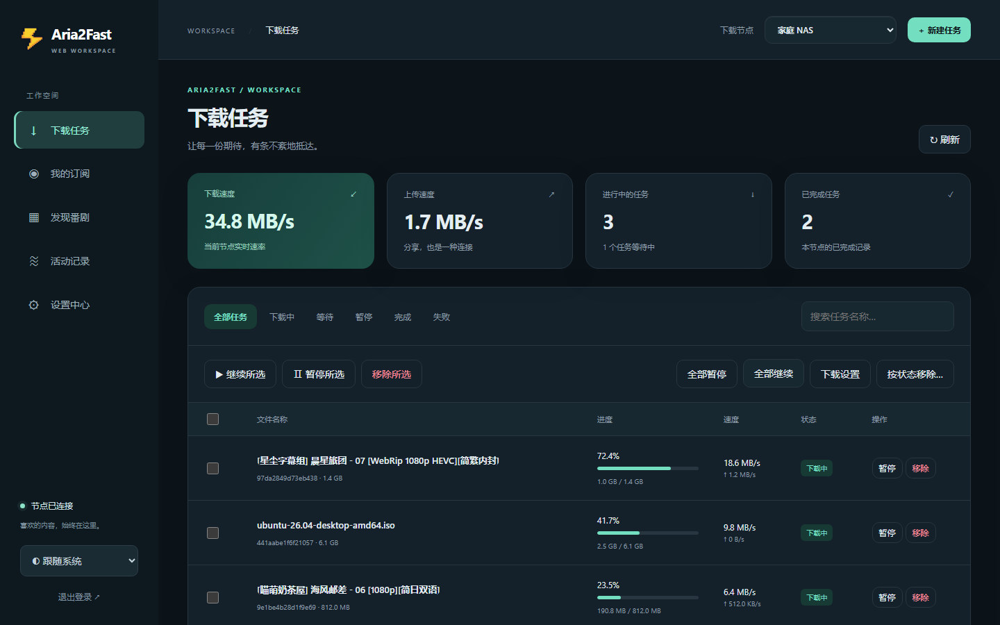
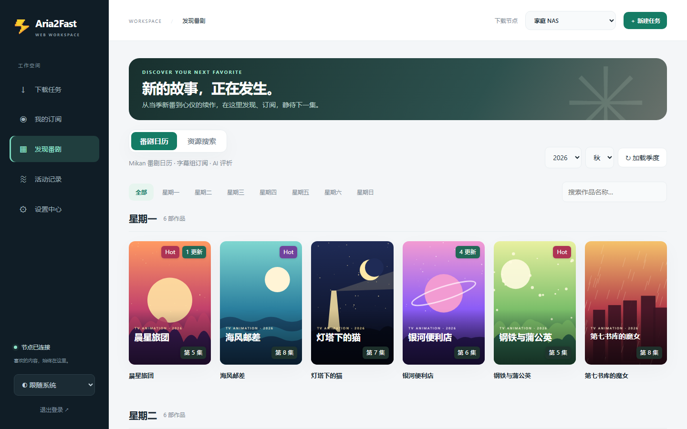
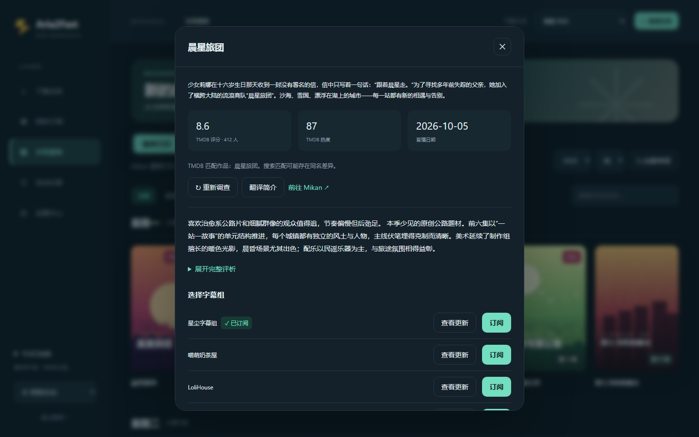
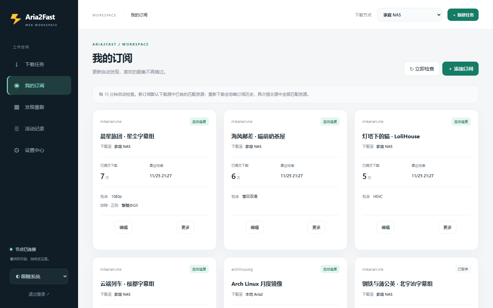
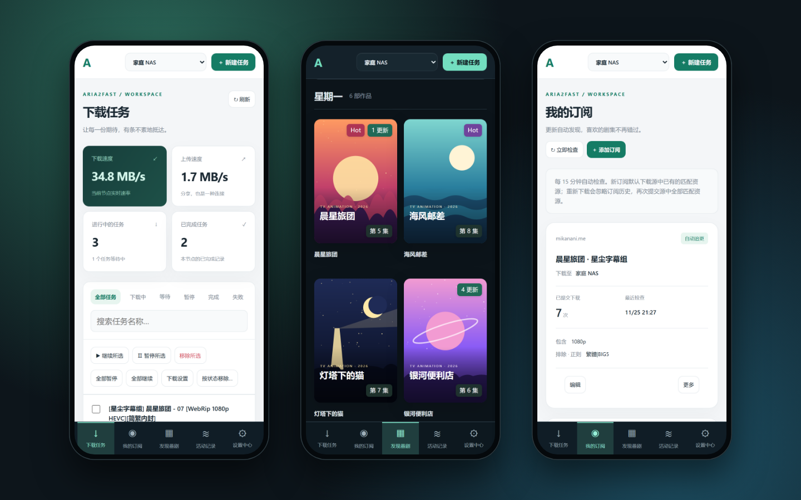

<div align="center">


# Aria2Fast Web

**好看又好用的 Aria2 网页面板：下载管理、追番订阅、AI 番剧评析，电脑和手机都能用。**

[](https://github.com/aiqinxuancai/Aria2Fast.Web/releases)
[](https://github.com/aiqinxuancai/Aria2Fast.Web/pkgs/container/aria2fast.web)

[](LICENSE.txt)

[快速开始](#快速开始) · [功能](#功能) · [截图](#截图) · [常见问题](#常见问题)



</div>

## 功能

- ⚡ **一处管理所有下载**：支持 HTTP、FTP、磁力链接、种子和 Metalink，可暂停、限速、选择种子内的文件；多台 Aria2（本机、NAS、服务器）一键切换。
- 📺 **追番自动下载**：订阅任意 RSS，或在番剧日历里直接点「订阅」字幕组，新的一集发布后自动开始下载，可用关键词或正则过滤。
- 🔍 **发现新番**：按季度、星期浏览 Mikan 新番，显示热度和更新集数，可接入 TMDB 评分。
- 🌐 **多源搜索补源**：一次搜索 ACG.RIP、Nyaa、动漫花园、末日动漫，还能接入 Prowlarr / Jackett 覆盖更多公开站和 PT 站；搜索结果可直接下载，或一键转为订阅。
- 🤖 **AI 帮你挑番、整理文件**：AI 搜索资料写出番剧评析、翻译简介、按作品自动分文件夹、整理已下载文件的名称。支持 OpenAI、Claude、Gemini 及其兼容接口。
- 🔔 **下载完成提醒**：通过 PushDeer 或 Bark 推送到手机。
- 📱 **手机也好用**：响应式布局加底部导航，浅色/深色主题可跟随系统；已完成的文件可以直接用浏览器取回。
- 📦 **开箱即用**：Docker 一条命令部署；Windows 和 macOS 解压就能运行，已内置 aria2。

## 截图

<table>
  <tr>
    <td width="50%"></td>
    <td width="50%"></td>
  </tr>
  <tr>
    <td align="center"><b>发现番剧</b>：按季度、星期浏览新番</td>
    <td align="center"><b>番剧详情</b>：TMDB 评分、AI 评析、一键订阅字幕组</td>
  </tr>
  <tr>
    <td width="50%"></td>
    <td width="50%"></td>
  </tr>
  <tr>
    <td align="center"><b>我的订阅</b>：自动追更，过滤规则一目了然</td>
    <td align="center"><b>手机界面</b>：随时随地管理下载</td>
  </tr>
</table>

## 快速开始

### Docker（推荐，适合 NAS / 服务器）

新建一个文件夹，保存下面的内容为 `compose.yaml`：

```yaml
services:
  aria2fast:
    image: ghcr.io/aiqinxuancai/aria2fast.web:latest
    restart: unless-stopped
    ports:
      - "8080:8080"         # 网页
      - "16888:16888/tcp"   # BT
      - "16888:16888/udp"   # DHT
    environment:
      TZ: Asia/Shanghai
      ARIA2FAST_PASSWORD: change-me-please   # 改成你自己的登录密码，至少 12 位
    volumes:
      - app-data:/data
      - downloads:/downloads

volumes:
  app-data:
  downloads:
```

然后启动：

```bash
docker compose up -d
```

浏览器打开 `http://服务器IP:8080` 即可登录。如果不设置 `ARIA2FAST_PASSWORD`，程序会生成随机密码，用 `docker compose exec aria2fast cat /data/initial-password.txt` 查看。

想把文件直接下载到宿主机目录、指定镜像版本或从源码构建，请看 [部署与配置](docs/DEPLOYMENT.md)。

### Windows / macOS

1. 在 [Releases](https://github.com/aiqinxuancai/Aria2Fast.Web/releases) 下载对应平台的压缩包，解压到任意可写目录。
2. Windows 双击 `Start.cmd`；macOS 双击 `Start.command`。
3. 浏览器会自动打开。首次登录的随机密码保存在程序目录的 `data/initial-password.txt`，终端窗口会显示它的位置。

在设置中可以开启开机自启、创建桌面快捷方式。macOS 版本暂未签名，首次运行可能需要在「系统设置 → 隐私与安全性」中允许。

### 用手机访问

手机和电脑连同一个局域网，浏览器打开 `http://电脑IP:8080`。Windows 首次使用时请在防火墙提示中允许访问。

## 使用指南

1. **修改密码**：登录后在「设置中心」修改初始密码。
2. **添加下载**：点右上角「新建任务」，粘贴链接或磁力链接，也可以上传种子文件。
3. **订阅番剧**：在「发现番剧」中打开作品，选择字幕组点「订阅」；也可以在「我的订阅」添加任意 RSS 地址。
4. **连接更多 Aria2**：在「设置中心」添加远程 Aria2 的 RPC 地址和密钥，之后在右上角切换节点。
5. **可选增强**：在设置中填写 AI 服务、TMDB、搜索服务或推送的 Key，即可开启对应功能。AI 评析的原理和配置见 [番剧调查与评析](docs/AI-RESEARCH.md)。

## 常见问题

<details>
<summary><b>忘记密码怎么办？</b></summary>

设置环境变量 `ARIA2FAST_PASSWORD`（至少 12 位）后重启程序，即可用新密码登录。设置后密码由环境变量管理。

</details>

<details>
<summary><b>BT 下载速度很慢？</b></summary>

请确认 16888 端口（TCP 和 UDP）已在 Docker、防火墙和路由器中放行。下载公开资源时，可以在「设置中心 → 下载设置」开启公共 Tracker 自动更新（PT 私有种子请勿开启）。更多参数见 [下载调优](docs/DEPLOYMENT.md#下载调优)。

</details>

<details>
<summary><b>番剧页面打不开，或者种子下载失败？</b></summary>

在「设置中心」配置网络代理，或填写 Mikan 种子备用站点，详见 [Mikan 种子备用站点](docs/DEPLOYMENT.md#mikan-种子备用站点)。搜索源打不开时，可以改用镜像地址，或通过 Prowlarr / Jackett 接入，详见 [资源搜索源](docs/DEPLOYMENT.md#资源搜索源)。

</details>

<details>
<summary><b>可以从外网访问吗？</b></summary>

可以，但请通过 HTTPS 反向代理访问，并且不要对外暴露 Aria2 RPC 端口。详见 [公网访问与安全](docs/DEPLOYMENT.md#公网访问与安全)。

</details>

## 文档

- [部署与配置](docs/DEPLOYMENT.md)：Docker 进阶、环境变量、下载调优、网络设置、资源搜索源
- [桌面集成](docs/DESKTOP.md)：开机自启、桌面快捷方式、端口占用处理
- [番剧调查与评析](docs/AI-RESEARCH.md)：AI 评析的工作方式与搜索服务配置
- [功能说明](docs/FEATURES.md)：与桌面版的功能对照
- [开发与发布](docs/DEVELOPMENT.md)：源码运行、测试、构建与发布流程

## 许可证

本项目衍生自 [Aria2Fast](https://github.com/aiqinxuancai/Aria2Fast)，以 [GPL-3.0](LICENSE.txt) 许可证发布，第三方组件见 [THIRD-PARTY-NOTICES.md](THIRD-PARTY-NOTICES.md)。
