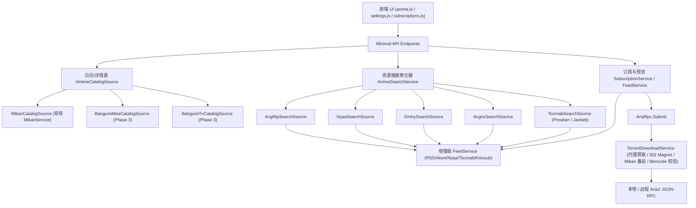

# 多动漫下载源调研报告与接入规划

> **实施状态（2026-11-25）**：Phase 1 + Phase 2 已完成，Phase 3（Bangumi.moe / Bangumi.tv 日历源）尚未开始。与本文设计的差异：
>
> - 搜索源接口为 `FeedUrl(query)`，抓取、超时、缓存和错误描述统一在 `AnimeSearchService` 中处理，四个内置站点共用 `RssSearchSource`。
> - Torznab API Key 不写入订阅地址，由 `FeedService.Fetch` 按端点地址在请求时注入；备份导出时隐藏下载记录中的 Key。比仅在界面上隐藏更安全。
> - `TorrentDownloadService` 由 `AriaRpc` 内部创建（保持现有构造函数）；Mikan 种子始终预取，`ProxyTorrentDownloads` 只控制其他 `.torrent` 与 Torznab 链接；Web 服务连不上站点时退回由节点直接下载。
> - 源配置放在设置中心新的「资源搜索源」分区，预取开关在「下载设置 → 订阅与网络」。
> - 仅属于 Phase 3 的部分（`AnimeCard.Source`、带前缀的番剧 ID、`DefaultCatalogSource`、Bangumi.moe / Bangumi.tv 配置）暂未添加。

## 目标与背景

本规划旨在系统调研 **Aria2Fast.Web** 除 **Mikan（蜜柑计划）** 外可接入的常见动漫下载源，并结合项目现有架构（ASP.NET Core 10 + 原生 JS 前端 + Aria2 JSON-RPC）制定一套可扩展、低维护成本、完全向后兼容的多源接入实施方案。

### 现有代码架构诊断（为什么目前难以直接接入其他源）

通过审查项目核心链路，系统目前存在以下 4 个关键耦合点：

1. **「探索番剧」页强绑定 Mikan HTML 结构**
   - [AnimeEndpoints.cs](../src/Aria2Fast.Web/Endpoints/AnimeEndpoints.cs) 直接注入 [MikanService.cs](../src/Aria2Fast.Web/Services/MikanService.cs)，未抽象数据源接口。
   - 番剧 ID 校验在 `MikanService` 与 `AnimeEndpoints` 中均写死为纯数字 `^\d{1,12}$`，且 [AiService.cs](../src/Aria2Fast.Web/Services/AiService.cs) 直接以 `id` 作为 `state.Reviews` 持久化缓存键。
   - [anime.js](../src/Aria2Fast.Web/wwwroot/js/anime.js) 仅支持「按季度加载日历 + 前端过滤当前季度标题」，缺乏**服务端全网搜源**与**番剧详情页跨源补源**入口。
2. **`FeedService` 仅实现基础 RSS/Atom，缺少主流动漫 BT 站的 XML 扩展字段支持**
   - [FeedService.cs](../src/Aria2Fast.Web/Services/FeedService.cs) 仅解析标准 `enclosure/@url`、`link` 与 `enclosure/@length`。
   - **Nyaa.si** 不输出 `<enclosure>`，将文件大小放在 `<nyaa:size>1.4 GiB</nyaa:size>`（非纯数字字节），而前端 [core.js](../src/Aria2Fast.Web/wwwroot/js/core.js#L4) 的 `bytes()` 对非数字字符串会回退显示为 `0 B`；同时其 `<nyaa:infoHash>`、`<nyaa:seeders>` 等高价值元数据未被提取。
   - **Torznab（Prowlarr / Jackett）** 使用 `<torznab:attr name="magneturl|size|seeders|infohash" .../>`。
   - **Kisssub / Comicat** 在部分 RSS 输出中缺少 `<enclosure>`，仅返回详情页 `show-{40位Hash}.html`。
3. **`.torrent` 服务端代理预取目前仅对 Mikan 域名生效**
   - [AriaRpc.cs](../src/Aria2Fast.Web/Services/AriaRpc.cs#L85-L97) 仅当 [MikanTorrentDownload.cs](../src/Aria2Fast.Web/Services/MikanTorrentDownload.cs#L8-L12) 命中 Mikan 域名时，才由 Web 服务端走 `ProxyUrl` 预下载种子、做 Bencode 校验并通过 `aria2.addTorrent` 提交。
   - 其他站点（如 **ACG.RIP、Nyaa.si、Bangumi.moe、ACGNX、Torznab**）的 `.torrent` URL 会直接交给 `aria2.addUri`，导致 Aria2 节点在无代理或遇站点拦截/302 跳转磁力链时频繁下载失败或把 HTML 错误页当作种子。
4. **「日历型源」与「搜索型源」产品形态差异**
   - 除 Mikan 和 Bangumi.moe 外，绝大多数动漫 BT 站（ACG.RIP、DMHY、Nyaa、ACGNX、Prowlarr/Jackett）均为**无新番日历的搜索/列表型站点**，需要通过「日历元数据发现 + 多源搜索/转 RSS 订阅」的双模式架构才能获得一致的追番体验。

---

## 主流动漫下载源调研与评估矩阵

基于接口规范、资源覆盖度、中文社区生态、2025–2026 年实际运行状态与反爬风险，除 Mikan 外的常见源划分为三个梯队：

### 第一梯队：高价值主力源（强烈推荐接入）

| 下载源 | 定位与资源优势 | 源类型 | 核心接口 / RSS 形态 | 下载链接形态 | 网络与反爬风险 | 接入性价比 |
| :--- | :--- | :--- | :--- | :--- | :--- | :--- |
| **ACG.RIP**<br>`acg.rip` | 华语新番/主流字幕组覆盖极全，页面清爽，国内环境口碑最好 | 搜索 / 列表型 | RSS 2.0：<br>`/.xml`<br>`/.xml?term={kw}`<br>`/1.xml?term={kw}`（动画分类） | `<enclosure>` 直出 `.torrent` | 国内直连可用性相对较好，反爬压力低 | ⭐⭐⭐⭐⭐<br>**极高** |
| **Nyaa.si**<br>`nyaa.si` | 全球最大动漫 BT 站：生肉、英字、BDRip、老番合集、繁中/双语首发最全 | 搜索 / 列表型 | RSS 2.0 + `nyaa:` 命名空间：<br>`/?page=rss&q={kw}&c={cat}&f={filter}` | `<link>` 为 `.torrent`，且自带 `<nyaa:infoHash>` 可直接合成 `magnet:` | 大陆需代理或镜像；无复杂 JS 挑战 | ⭐⭐⭐⭐⭐<br>**极高** |
| **DMHY 动漫花园**<br>`share.dmhy.org` | 华语最老牌综合动漫 BT 站，字幕组与冷门/老番最全 | 搜索 / 列表型 | RSS 2.0：<br>`/topics/rss/rss.xml?keyword={kw}&sort_id=2` | `<enclosure>` 直接返回 `magnet:?xt=...` | 大陆屏蔽，主站偶发 Cloudflare 波动；需支持**自定义镜像/CF Worker**（如 `dmhy-filename-rss`）与代理 | ⭐⭐⭐⭐<br>**高** |
| **Torznab 协议**<br>（**Prowlarr / Jackett**） | **一次接入，通吃上百个公开站与 PT 私有动漫站**（U2、M-Team、SkyeySnow、AnimeBytes 等），契合本项目 Docker / Unraid 用户群 | 统一聚合协议 | 标准 Torznab XML：<br>`/api?apikey={key}&t=search&cat=5070&q={kw}` | `<enclosure>` / `<link>`（常 302 跳 `magnet:`）或 `<torznab:attr name="magneturl">` | 由用户自建 Prowlarr/Jackett（可配 FlareSolverr）统一解决反爬与站点变动，**零维护负担** | ⭐⭐⭐⭐⭐<br>**极高（推荐必接）** |

### 第二梯队：特色补充源（按需分阶段接入）

| 下载源 | 定位与资源优势 | 源类型 | 核心接口 / RSS 形态 | 下载链接形态 | 网络与反爬风险 | 接入建议 |
| :--- | :--- | :--- | :--- | :--- | :--- | :--- |
| **Bangumi.moe（萌番组）**<br>`bangumi.moe` | **极少数与 Mikan 结构同构的源**：自带当季新番日历、封面、多语言名、Tag/字幕组映射与 REST JSON API | **日历 + 搜索 + 字幕组** | JSON API：`/api/bangumi/current`、`/api/v2/torrent/search`<br>RSS：`/rss/tags/{tagId1}+{tagId2}`、`/rss/search/{kw}` | `.torrent` 与 `magnet:` 均提供 | 大陆直连已阻断，必须通过代理或镜像；后端历史偶发缓存报错 | 作为「探索番剧」**第二原生番剧日历源**（Phase 3） |
| **ACGNX（末日动漫）**<br>`share.acgnx.se` / `.net` | DMHY 风格华语动漫 BT 站，可作为动漫花园的高兼容性备用源 | 搜索 / 列表型 | RSS 2.0：<br>`/rss.xml?keyword={kw}`<br>支持发布组/用户 RSS | `<enclosure>` `.torrent` / `magnet:` | 域名偶有切换/屏蔽，需允许自定义 BaseUrl 与代理 | 与 DMHY 共享配置形态，开发成本极低（Phase 1） |
| **Bangumi.tv（番组计划）**<br>`api.bgm.tv` | 非下载源，但提供**最权威稳定的公开每日新番放送日历 API**（中文/日文原名、封面、评分、ID） | **中立日历元数据层** | 官方 JSON API：<br>`GET https://api.bgm.tv/calendar` | 无（通过番剧名联动上述搜索源一键找源与生成订阅） | 需带合规 User-Agent；部分地区偶发波动，支持代理 | 当 Mikan 不可用时，仍可浏览新番日历并从 ACG.RIP/DMHY/Nyaa 追番（Phase 3） |
| **SubsPlease**<br>`subsplease.org` | 欧美最快实时跟播英字压制组，自带星期放送表与分辨率直链 RSS | 日历 + 固定组 RSS | RSS：`/rss/?r=1080`（720/480）<br>网页/社区 JSON 排期表 | `magnet:` / `.torrent` | 海外直连良好，基本无中文字幕 | 用户可直接通过「我的订阅」填 RSS 接入，无需定制爬虫 |

### 第三梯队：仅做通用 RSS 兜底 / 不建议投入定制适配

| 下载源 | 现状与限制 | 建议处理方式 |
| :--- | :--- | :--- |
| **Kisssub（爱恋）** / **Comicat（漫猫）**<br>`kisssub.org` / `comicat.org` | 同源老牌华语站，支持 `/rss-{kw}.xml`，但反爬 Cookie 校验频繁、偶发非标准 XML，且部分 RSS 条目无 `<enclosure>` 仅含 `show-{40位hash}.html` | **不做专用站内爬虫**；仅在 `FeedService` 增强 `show-{40hex}.html` 自动合成磁力链的兜底解析，进阶用户建议走 Prowlarr/Jackett (Torznab) |
| **TokyoTosho** / **AniDex** | 活跃资源与字幕组已高度向 Nyaa 集中，且 TokyoTosho RSS `<description>` 格式老旧 | 依赖 `FeedService` 通用 RSS 兼容，不做专用适配 |
| **AnimeTosho**<br>`animetosho.org` | **已启动停更/归档流程**，不再持续收录新番种子 | **明确排除**，不作为实时下载源开发 |

---

## 待确认的设计决策

在进入代码实施前，需确认以下 4 项核心设计决策：

1. **实施阶段与首批接入范围**
   - **选项 A（推荐，分步稳妥）**：先完成 **Phase 1 + Phase 2** —— 底层 RSS/种子代理预取增强 + 内置搜索源（**ACG.RIP、Nyaa.si、DMHY、ACGNX**）+ **Torznab（Prowlarr/Jackett）** 聚合协议，并在前端提供「全网搜源」与「番剧详情跨源补源」。
   - **选项 B（仅轻量直连源）**：仅做 **Phase 1**（ACG.RIP、Nyaa.si、DMHY、ACGNX + 底层增强），暂不引入 Torznab。
   - **选项 C（一步到位全量）**：包含 **Phase 1 + Phase 2 + Phase 3**，额外把 **Bangumi.moe** 与 **Bangumi.tv 公开日历**接入「探索番剧」日历切换。
2. **前端交互入口形态**
   - **选项 A（推荐）**：在现有「探索番剧」页面顶部增加双模式切换——「**番剧日历**」与「**资源搜索**」（支持单源/多源聚合搜索、一键下载、一键转为 RSS 订阅），同时在**番剧详情弹窗**内新增「**在其他源中搜索**」快捷入口，自动用当前作品名去已启用源中找资源。
   - **选项 B**：在主导航栏新增独立的「搜源」一级页面，保持「探索番剧」专注日历浏览。
3. **通用 `.torrent` 服务端代理预取策略**
   - 建议将 [MikanTorrentDownload.cs](../src/Aria2Fast.Web/Services/MikanTorrentDownload.cs) 泛化为通用 `.torrent` 代理预取服务：对来自内置动漫源或 Torznab 的 `.torrent` 链接（以及可选开关控制是否对所有 HTTP `.torrent` 链接生效），统一由 Web 服务端走 `ProxyUrl` 拉取、自动处理 **302 重定向到 `magnet:`**、校验 Bencode 合法性，再通过 `aria2.addTorrent` 提交给下载节点。
4. **反爬与镜像边界**
   - 支持为每个源配置**自定义源站/镜像地址**并复用全局 `ProxyUrl`，**不内置**绕过 Cloudflare 验证码/Turnstile 的机制；若某站点触发人机验证，推荐用户填入镜像站或通过自建 Prowlarr/Jackett（Torznab）接入。

---

## 实施方案设计

### 总体分层架构



---

### 模块 1：通用底层基础设施（Feed 解析与种子代理预取）

此层改动对**所有**新旧订阅源均立即生效，即使仅在「我的订阅」手动粘贴任意动漫站 RSS 链接也会直接受益。

#### `[MODIFY]` [Subscription.cs](../src/Aria2Fast.Web/Models/Subscription.cs)
- 扩展 `FeedItem` 以承载更多 BT 元数据，同时保持原有字段与 JSON 序列化完全兼容（新字段均带默认值）：

```csharp
public sealed record FeedItem(
    string Key,
    string Title,
    string Url,
    DateTimeOffset? Published,
    string Size,
    string? InfoHash = null,
    int? Seeders = null,
    int? Leechers = null,
    string? PageUrl = null,
    string? Category = null);
```

- `AnimeCard`、`AnimeDetail` 增加可选 `string Source = "mikan"` 字段，保持旧前端/测试脚本兼容。

#### `[MODIFY]` [FeedService.cs](../src/Aria2Fast.Web/Services/FeedService.cs)
增强 `FeedService.Parse(string xml, string baseUrl)`，支持以下站点扩展规范：
1. **Nyaa 命名空间 (`nyaa:*`)**：
   - 解析 `<nyaa:infoHash>`、`<nyaa:seeders>`、`<nyaa:leechers>`、`<nyaa:category>`。
   - 解析 `<nyaa:size>`（如 `1.4 GiB`、`320.5 MiB`），通过统一解析器转为纯字节数字字符串填入 `Size`，避免前端 `bytes()` 显示 `0 B`。
2. **Torznab 命名空间 (`torznab:attr`)**：
   - 提取 `name="magneturl"`、`name="infohash"`、`name="size"`、`name="seeders"`、`name="peers"` 及标准 `<size>` 节点。
3. **Kisssub / Comicat 兜底兼容**：
   - 当条目缺少 `<enclosure>` 且 `<link>` 匹配 `show-([a-fA-F0-9]{40})\.html` 时，自动合成 `magnet:?xt=urn:btih:{hash}` 作为下载地址，并保留原详情页到 `PageUrl`。
4. **下载链接优先级规范化**：
   - 优先级：`enclosure[@url]`（`.torrent` 或 `magnet:`） > `torznab:attr[@name="magneturl"]` > 直接指向 `.torrent`/`magnet:` 的 `<link>` > 由 `nyaa:infoHash` / `torznab:attr[@name="infohash"]` 合成的 `magnet:` > `Kisssub/Comicat` hash 合成的 `magnet:` > 普通 `<link>`。
   - 同时保留原始网页详情页链接到 `PageUrl`（便于搜索结果点击跳转源站查看）。

#### `[NEW]` `src/Aria2Fast.Web/Services/TorrentDownloadService.cs`（兼容 [MikanTorrentDownload.cs](../src/Aria2Fast.Web/Services/MikanTorrentDownload.cs)）
- 保留现有 Mikan 主/备站点故障转移（`MikanBaseUrl` -> `MikanFallbackUrl`）与 16 MB 限制 + 严格 Bencode 校验，确保 [mikan_fallback.py](../tests/mikan_fallback.py) 100% 行为一致。
- 扩展服务端代理预取能力：
  - 新增 `ProxyTorrentDownloads` 配置开关（默认开启，仅匹配 `.torrent` 或已配置 Torznab 端点下载路径，不影响普通 HTTP 文件下载）。
  - **支持 302 跳转 `magnet:`**：关闭 `AllowAutoRedirect` 手动跟踪最多 5 跳；若遇到 `Location: magnet:?xt=...`（Prowlarr / Jackett / 部分站点常见行为），直接返回磁力链交给 `aria2.addUri`；若最终响应为二进制种子，则执行 Bencode 校验后返回字节流交给 `aria2.addTorrent`。
- 更新 [AriaRpc.cs](../src/Aria2Fast.Web/Services/AriaRpc.cs#L85-L97) 调用 `TorrentDownloadService`。

---

### 模块 2：配置模型与数据源注册

#### `[MODIFY]` [AppState.cs](../src/Aria2Fast.Web/Models/AppState.cs)
在 `WebSettings` 中新增非破坏性配置字段（所有新字段提供默认值，旧版 `state.json` 无需迁移脚本）：

```csharp
public bool ProxyTorrentDownloads { get; set; } = true;
public AnimeSourcesSettings AnimeSources { get; set; } = new();
```

```csharp
public sealed class AnimeSourcesSettings
{
    public string DefaultCatalogSource { get; set; } = "mikan";
    public SearchSourceConfig AcgRip { get; set; } = new() { Enabled = true, BaseUrl = "https://acg.rip" };
    public SearchSourceConfig Nyaa { get; set; } = new() { Enabled = true, BaseUrl = "https://nyaa.si" };
    public SearchSourceConfig Dmhy { get; set; } = new() { Enabled = true, BaseUrl = "https://share.dmhy.org" };
    public SearchSourceConfig Acgnx { get; set; } = new() { Enabled = false, BaseUrl = "https://share.acgnx.se" };
    public SearchSourceConfig BangumiMoe { get; set; } = new() { Enabled = false, BaseUrl = "https://bangumi.moe" };
    public SearchSourceConfig BangumiTv { get; set; } = new() { Enabled = false, BaseUrl = "https://api.bgm.tv" };
    public List<TorznabEndpoint> Torznab { get; set; } = [];
}

public sealed class SearchSourceConfig
{
    public bool Enabled { get; set; }
    public string BaseUrl { get; set; } = "";
}

public sealed class TorznabEndpoint
{
    public string Id { get; set; } = Guid.NewGuid().ToString("N");
    public string Name { get; set; } = "Prowlarr / Jackett";
    public string Url { get; set; } = "";        // 例如 http://127.0.0.1:9696/1/api
    public string ApiKey { get; set; } = "";     // 通过 query 参数 apikey 传递，服务端日志脱敏
    public string Categories { get; set; } = "5070"; // 默认 Anime 分类，可留空
    public bool Enabled { get; set; } = true;
}
```

#### `[MODIFY]` [ConfigurationEndpoints.cs](../src/Aria2Fast.Web/Endpoints/ConfigurationEndpoints.cs)
- 在 `PUT /api/settings` 中校验各启用源的 `BaseUrl` 及 `Torznab` 端点 URL（复用 `Validation.HttpUrl`）。
- 新增 `POST /api/anime/torznab/test`：发送 `?t=caps&apikey=...` 验证 Prowlarr/Jackett 连通性与返回能力（类似现有 `/api/ai/test-profile`）。

---

### 模块 3：可插拔多源检索与日历抽象

#### `[NEW]` `src/Aria2Fast.Web/Services/Sources/IAnimeSearchSource.cs`
定义统一的搜索型下载源抽象：

```csharp
public interface IAnimeSearchSource
{
    string Id { get; }          // "acgrip", "nyaa", "dmhy", "acgnx", "torznab:{id}"
    string Name { get; }
    bool SupportsDirectRss { get; }
    Task<AnimeSearchResponse> SearchAsync(AnimeSearchQuery query, CancellationToken ct);
}

public sealed record AnimeSearchQuery(string Keyword, string? Category = null, string? Filter = null);
public sealed record AnimeSearchResponse(
    string SourceId,
    string SourceName,
    string? SubscribeRssUrl,    // 可直接填入「添加订阅」的标准 RSS 链接
    List<FeedItem> Items,
    string? Error = null);
```

每次搜索均同步返回 `SubscribeRssUrl`（如 ACG.RIP 生成 `https://acg.rip/.xml?term=xxx`，Nyaa 生成 `https://nyaa.si/?page=rss&q=xxx&c=1_2`）。用户点击「一键订阅此搜索」即可无缝复用现有 [SubscriptionService.cs](../src/Aria2Fast.Web/Services/SubscriptionService.cs) 的全部能力（过滤正则、排除关键词、季度目录、AI 分目录、OSS 同步、历史去重）。

#### `[NEW]` 具体搜索源实现（`src/Aria2Fast.Web/Services/Sources/`）
- **`AcgRipSearchSource.cs`**：拼接 `{BaseUrl}/1.xml?term={keyword}`（或全分类 `/.xml?term={keyword}`），经 `FeedService.Fetch` 解析。
- **`NyaaSearchSource.cs`**：拼接 `{BaseUrl}/?page=rss&q={keyword}&c={category}&f={filter}`（默认 `c=1_0` 全动漫，可选 `1_2` 英字、`1_3` 非英字/中字、`1_4` 生肉；`f=0` 全部 / `2` 仅可信），复用 `FeedService` 解析 `nyaa:*` 字段。
- **`DmhySearchSource.cs`**：拼接 `{BaseUrl}/topics/rss/rss.xml?keyword={keyword}&sort_id=2`（支持全部分类），复用 `FeedService` 提取磁力链。
- **`AcgnxSearchSource.cs`**：拼接 `{BaseUrl}/rss.xml?keyword={keyword}`，复用 `FeedService`。
- **`TorznabSearchSource.cs`**（Phase 2）：遍历启用的 `TorznabEndpoint`，请求 `{Url}?t=search&apikey={ApiKey}&cat={Categories}&q={keyword}`，返回 `FeedItem` 列表及对应 Torznab RSS 订阅链接（界面展示与日志中**脱敏隐藏 `apikey`**）。
- **`AnimeSearchService.cs`**：统一调度层，支持单源或 `source=all` 并行聚合搜索（带单源独立超时与 3 分钟短期内存缓存，单源失败不阻塞其他源并返回源级错误信息）。

#### `[NEW]` 日历源抽象（Phase 3，按需启用）
- **`IAnimeCatalogSource.cs`**：抽象 `List(year, season, refresh)`、`Detail(id, generateAi)`、`Badges(id)`。
- **`MikanCatalogSource.cs`**：包装现有 [MikanService.cs](../src/Aria2Fast.Web/Services/MikanService.cs)，Mikan ID 继续沿用纯数字（如 `"3456"`），100% 兼容历史 `state.Reviews` 缓存与现有 API 测试。
- **`BangumiMoeCatalogSource.cs`**：
  - `List` 调用 `{BaseUrl}/api/bangumi/current` 获取当季新番日历、封面与 `tag_id`，按 `showOn` 映射为星期一～星期日。
  - `Detail` 根据 `tag_id` 拉取关联发布组列表，拼装 `/rss/tags/{bangumiTagId}+{teamTagId}` 作为 `AnimeGroup.Url`，直接对接现有「查看更新 / 订阅」交互。
  - ID 采用命名空间前缀 `bangumimoe:{id}`。
- **`BangumiTvCatalogSource.cs`**：
  - `List` 调用 `https://api.bgm.tv/calendar`，映射为每日放送表（含中文名、日文原名、封面、评分）。
  - `Detail` 返回番剧简介与元数据，并将已启用的搜索源自动生成为按作品名搜索的订阅组列表。
  - ID 采用命名空间前缀 `bgmtv:{subjectId}`。

---

### 模块 4：后端 API 与服务注册

#### `[MODIFY]` [AnimeEndpoints.cs](../src/Aria2Fast.Web/Endpoints/AnimeEndpoints.cs)
- 新增 `GET /api/anime/sources`：返回已配置的日历源与搜索源列表（不含 `Torznab.ApiKey` 等敏感密钥）。
- 新增 `GET /api/anime/search?source=all&q=...&category=...&filter=...`：调用 `AnimeSearchService`。
- 兼容扩展现有路由：
  - `GET /api/anime?source=mikan&year=...&season=...&refresh=...`
  - `GET /api/anime/{id}` 与 `POST /api/anime/{id}/review`：将 ID 校验放宽为 `^(\d{1,12}|[a-z0-9_-]{2,16}:[a-zA-Z0-9_-]{1,64})$`，按前缀路由至对应 `IAnimeCatalogSource`（无前缀默认 Mikan）。

#### `[MODIFY]` [Program.cs](../src/Aria2Fast.Web/Program.cs)
- 注册 `TorrentDownloadService`、各 `IAnimeSearchSource`、`AnimeSearchService` 及 `IAnimeCatalogSource` 实现。

---

### 模块 5：前端交互与设置中心

#### `[MODIFY]` [anime.js](../src/Aria2Fast.Web/wwwroot/js/anime.js)
1. **顶部模式切换**：在「探索番剧」页支持切换「番剧日历」与「资源搜索」（支持单源或全部已启用源、Nyaa 分类/可信筛选、关键词搜索）。
2. **搜索结果列表**：
   - 显示来源徽章（如 `ACG.RIP`、`Nyaa`、`DMHY`、`Prowlarr`）、资源标题、大小、做种/下载数（如有）、发布时间。
   - 操作按钮：「下载」（调用现有 `addTask`）、「打开原帖」（如有 `pageUrl`）。
   - 工具栏提供「**＋ 订阅当前搜索结果**」（有 `subscribeRssUrl` 时启用，直接弹出 `editSubscription({ name, url: subscribeRssUrl })`）。
3. **番剧详情弹窗跨源补源**：
   - 在现有「选择字幕组」区域下方增加「在其他下载源中搜索」快捷按钮，一键带入当前番剧标题发起跨源检索。
4. **日历源切换**（Phase 3）：当启用 Bangumi.moe 或 Bangumi.tv 时，在日历工具栏显示源站下拉框，并动态更新「前往源站 ↗」文案与提示信息。

#### `[MODIFY]` [settings.js](../src/Aria2Fast.Web/wwwroot/js/settings.js)
- 在「下载设置 → 订阅与网络」中新增：
  - 勾选框：「由服务端经代理预取 `.torrent` 种子文件」
  - 「**动漫搜索源配置**」子面板：支持启用/停用 ACG.RIP、Nyaa、DMHY、ACGNX（及 Phase 3 的 Bangumi.moe / Bangumi.tv）并自定义各自源站/镜像地址。
  - 「**Torznab 聚合索引器（Prowlarr / Jackett）**」管理卡片（Phase 2）：支持添加、编辑、删除及「测试连接」按钮（沿用现有 AI 配置卡片风格，移动端同步自适应）。

#### `[MODIFY]` [core.js](../src/Aria2Fast.Web/wwwroot/js/core.js) & [subscriptions.js](../src/Aria2Fast.Web/wwwroot/js/subscriptions.js)
- [core.js](../src/Aria2Fast.Web/wwwroot/js/core.js#L4)：`bytes()` 当传入空值或不可解析字符串时友好显示 `—`（而非 `0 B`）。
- [subscriptions.js](../src/Aria2Fast.Web/wwwroot/js/subscriptions.js)：订阅卡片展示源站 URL 时，自动对包含 `apikey=` 查询参数的 Torznab URL 做脱敏展示（如 `apikey=***`）。

---

## 验证计划

### 自动化测试

1. **编译与核心单元测试**：
   ```powershell
   dotnet build -c Release
   dotnet run --project tests/Aria2Fast.Web.Tests -c Release --no-build
   ```
   覆盖：
   - `FeedService.Parse` 解析 Nyaa（`nyaa:size` 换算、`nyaa:infoHash` 合成磁链、`nyaa:seeders`）、DMHY（`enclosure` 磁链）、ACG.RIP（`enclosure` `.torrent`）、Torznab（`torznab:attr`）、Kisssub/Comicat（`show-{40hex}.html` 兜底）及 XXE 防护；
   - `TorrentDownloadService` 通用 `.torrent` 代理预取、HTTP 302 跳转 `magnet:`、HTML 污染页拦截与超过 16 MB 拒绝；
   - 多源命名空间 ID 校验与 `AiService.CachedReview` 旧版数字 ID 向后兼容。

2. **HTTP Fixture 端到端集成测试**：
   ```powershell
   python tests/integration.py
   python tests/mikan_fallback.py
   ```
   - 扩展 [integration.py](../tests/integration.py) 使用本地 HTTP mock 模拟 ACG.RIP、Nyaa、DMHY、ACGNX、Torznab 及单源 503 故障隔离，验证 `/api/anime/search`、搜索结果转订阅、Torznab 脱敏与连接测试；
   - 运行 [mikan_fallback.py](../tests/mikan_fallback.py) 确认 Mikan 原有种子备站切换与旧失败任务重试零回归。

3. **浏览器回归测试（桌面 + 移动端）**：
   ```powershell
   cd tests/browser && node smoke.cjs
   ```
   - 验证「探索番剧」页日历/搜源切换、搜源结果渲染、一键订阅弹窗、设置中心多源与 Torznab 配置在桌面（1440×1000）与手机（390×844）视口下无脚本错误和布局溢出。

### 人工验证

1. 本地启动后，前往「设置中心 → 下载设置」确认内置源配置与 `.torrent` 代理预取开关可正常保存并持久化。
2. 在「探索番剧 → 资源搜索」中：
   - 直连测试 **ACG.RIP** 搜索中文新番，验证单条下载与「一键订阅此搜索」；
   - 配置 `ProxyUrl` 后测试 **Nyaa.si** 与 **DMHY** 搜索，验证文件大小、做种数、磁力链及 `.torrent` 代理提交；
   - 在 Mikan 番剧详情弹窗点击「在其他下载源中搜索」验证跨源补源。
3. （Phase 2）配置本地 Prowlarr / Jackett Torznab 地址与 API Key，测试连接、搜索与 302 跳转磁力链或 `.torrent` 下载提交。
